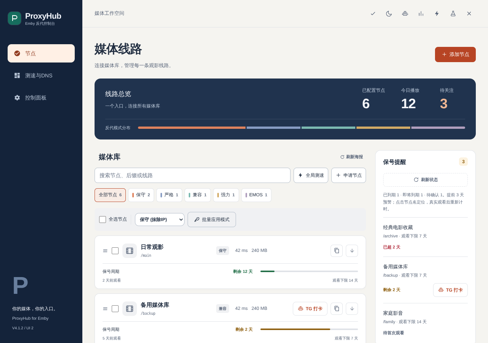
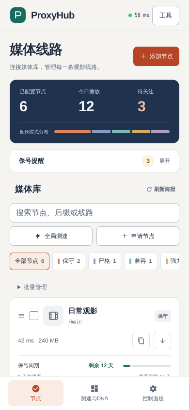
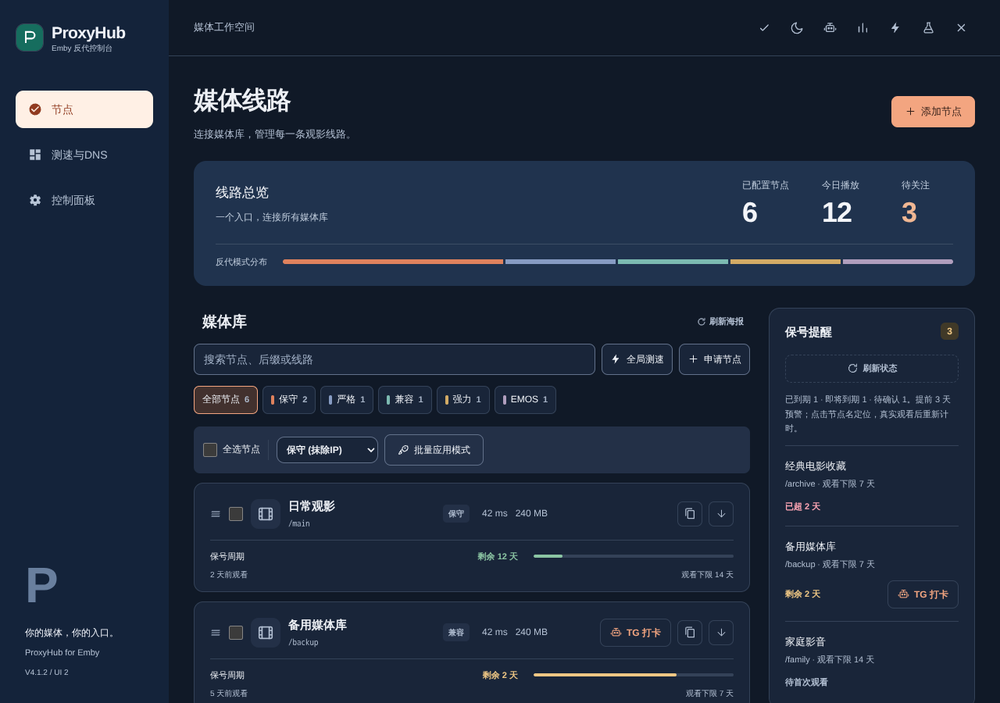

# ProxyHub 面板 UI 2 测试版

基于仓库根目录的 `4.1.2` 发布版。下载本目录的 **worker.js**，按原来的方式粘贴到测试 Worker 即可使用；沿用现有环境变量与 `DB` 绑定。

## 界面调整

- 午夜蓝侧栏、暖白工作区和铜橙操作色，完整的浅色 / 深色主题。
- 桌面重排为侧栏工作台：线路列表与右侧保号提醒并列。
- 总览展示真实节点数量、今日播放、待关注数量和反代模式分布。
- 手机首屏展示节点；提醒与批量管理可展开，工具收纳为带文字菜单。
- 节点编辑改为侧滑式全高面板，测速、DNS 与设置页重新分区。
- 保留原有入口、字段和权限限制，补齐筛选状态、键盘操作与手机输入尺寸。

## 预览

预览使用模拟节点与头像，实际部署显示你自己的数据。







此构建仅替换发布文件的登录页和主面板 HTML 常量，反代、鉴权、D1、签到与 API 代码沿用原版。

重新生成（Node.js 22+）：

```sh
node --experimental-vm-modules test/UI/build.mjs
```

`panel.css`、`panel.js` 是界面来源，构建时内嵌到单文件 Worker。普通自动更新仍指向主版本；测试界面期间请勿点击更新覆盖。

## 检查记录

- 320、390、768、1280、1920px 布局与浅色 / 深色主题；390px 使用 844px 高度，核心文字对比度 ≥ 4.5:1。
- 原业务脚本、DOM ID、代理 / 鉴权 / 数据库处理代码完整性。
- 键盘打开模式菜单、页面切换、手机弹窗保存按钮可达、登录页。
- 模拟接口下的节点编辑与 Bot 保存、筛选后编辑保存、主题菜单连续切换、订阅者只读界面与空数据总览。
- Impeccable 对新增 CSS / JS 的静态检查通过。
- 独立视觉复核列出的整改项已全部通过，结论为 ship（覆盖本轮整改范围）。

浏览器检查使用模拟数据，不访问真实源站。复现时将 `UI_TEST_TOOLS` 指向已安装 `playwright-core` 与 `@sparticuz/chromium` 的工具目录，`UI_TEST_OUTPUT` 指向截图目录：

```sh
UI_TEST_TOOLS=/path/to/browser-tools UI_TEST_OUTPUT=/tmp/proxyhub-ui-preview \
  node --experimental-vm-modules test/UI/verify.mjs
```

真实 Cloudflare / Emby 播放链路由测试部署验证。
